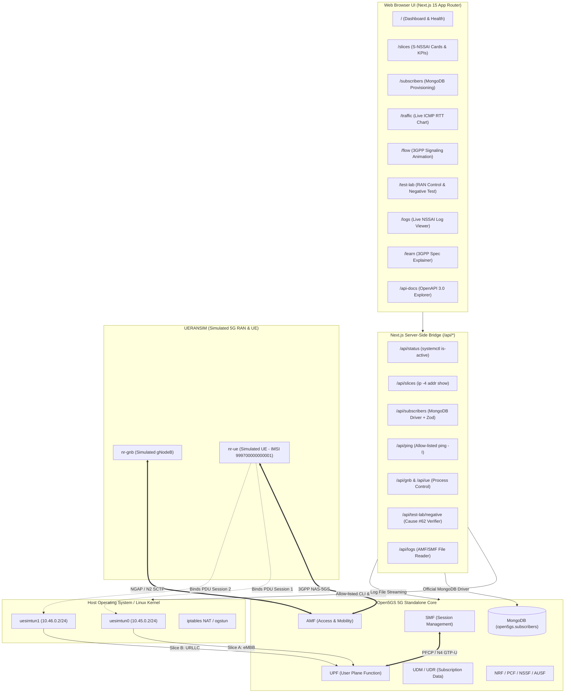

# 5G Network Slicing Dashboard & Bridge

[](https://nextjs.org/)
[](https://www.typescriptlang.org/)
[](https://tailwindcss.com/)
[](https://open5gs.org/)
[](https://github.com/aligungr/UERANSIM)
[](https://openapis.org/)

A full-stack, enterprise-grade 5G Network Slicing Dashboard and bridge layer built with **Next.js 15 (App Router)**, **TypeScript**, **Tailwind CSS**, and **shadcn/ui**. It interfaces with an **Open5GS 5G Core** and **UERANSIM (v3.2.6)** running on Ubuntu to provide real-time control, live monitoring, dynamic 3GPP signaling visualization, per-slice traffic isolation testing, and access authorization validation.

---

## Architecture Diagram



---

## 5G Slicing Deployment Specifications

| Parameter | Slice A (eMBB) | Slice B (URLLC) |
|---|---|---|
| **Slice / Service Type (SST)** | **1** (Enhanced Mobile Broadband) | **2** (Ultra-Reliable Low-Latency) |
| **Slice Differentiator (SD)** | `000001` (Hex, 24-bit) | `000002` (Hex, 24-bit) |
| **Standard S-NSSAI** | `SST: 1 \| SD: 000001` | `SST: 2 \| SD: 000002` |
| **Data Network Name (DNN)** | `internet` | `internet2` |
| **Allocated IP Pool** | `10.45.0.0/24` | `10.46.0.0/24` |
| **Assigned Linux TUN Interface** | `uesimtun0` | `uesimtun1` |
| **Subscriber IMSI / PLMN** | `999700000000001` / `999/70` | `999700000000001` / `999/70` |
| **ITU-R Target Focus** | High throughput (peak ~20 Gbps) | Low latency (~1 ms), 99.999% reliability |

---

## 3-Command Quickstart

```bash
# 1. Install dependencies
npm install

# 2. Build production assets
npm run build

# 3. Start the dashboard server
npm start
```
The dashboard will be accessible at: **[http://localhost:3000](http://localhost:3000)**.

For rapid development with hot-reloading:
```bash
npm run dev
```

---

## 5-Minute Live Presentation Script

Use this exact sequence during project demonstrations to present the full end-to-end functionality:

1. **Introduction & Concepts (`/learn`)**:
   - Navigate to `/learn`.
   - Explain the 5G slicing highway analogy: dedicated virtual networks running over shared physical infrastructure.
   - Use the **Interactive S-NSSAI Wire Decoder** to demonstrate how SST (8 bits) and SD (24 bits) form a 32-bit wire Information Element.
2. **5G Core Health & Topology (`/`)**:
   - Open `/` to verify all 10 Open5GS core network functions (`amfd`, `smfd`, `upfd`, `udmd`, etc.) are active.
3. **Subscriber Entitlement (`/subscribers`)**:
   - Open `/subscribers` to inspect IMSI `999700000000001` provisioned in MongoDB.
   - Show that the subscriber is entitled to both Slice A and Slice B.
4. **RAN Process Activation (`/test-lab`)**:
   - Open `/test-lab`. Start `nr-gnb` (verify N2 SCTP link to AMF) and start `nr-ue` (verify 3GPP Registration).
5. **Data Plane Traffic Isolation (`/traffic`)**:
   - Open `/traffic`. Click **"Ping via Slice A"** (`uesimtun0` ➔ `10.45.0.x`).
   - Click **"Ping via Slice B"** (`uesimtun1` ➔ `10.46.0.x`).
   - Show the real-time Recharts multi-line latency chart and raw terminal output proving packet segregation.
6. **Negative Authorization Test (`/test-lab`)**:
   - In `/test-lab`, execute the Negative Slicing Rejection Test requesting unprovisioned slice `SST: 3, SD: 000003`.
   - Show that Open5GS AMF immediately enforces access control and rejects the session with **3GPP 5GMM Cause #62 (Slice Not Supported)**.
7. **Interactive Signaling Walkthrough (`/flow`)**:
   - Open `/flow` to observe the animated 6-step registration and PDU session establishment sequence with decoded 3GPP Information Elements.
8. **OpenAPI Bridge Verification (`/api-docs`)**:
   - Open `/api-docs` to demonstrate self-documenting endpoints and execute live requests directly from the UI.

---

## Security Architecture

1. **Strict Command Allow-Listing**:
   The web frontend never issues arbitrary shell commands. All system interactions are mediated by server-side Route Handlers with hardcoded commands and parameter arrays executed via `child_process.execFile`:
   - `systemctl is-active <service>`
   - `ip -4 addr show <interface>`
   - `ping -I <uesimtun0|uesimtun1> -c <count> <target>`
2. **Zod Schema Validation**:
   All user inputs (IMSI strings, SST integers, hex SD formats, AMBR bandwidths) are strictly validated before MongoDB updates.
3. **Dual-Mode Resilient Execution**:
   - **Host Ubuntu Mode**: Automatically interacts with native Open5GS systemd services, UERANSIM TUN interfaces, and local MongoDB.
   - **Dev / Simulation Mode**: When run on Windows or developer laptops without Open5GS, the bridge seamlessly activates high-fidelity simulated telemetry so developers can test UI and workflows offline.

---

## Testing & Quality Control

```bash
# Run unit tests across all 8 test suites
npm test

# Run ESLint code quality checks
npm run lint

# Compile production bundle
npm run build
```

---

## API Reference

The project includes an **OpenAPI 3.0.3 specification** located at [`openapi.yaml`](file:///d:/SEMESTER%20-%207/Software%20Defined%20Networks/SDN%20USE%20CASE/openapi.yaml). You can also explore and execute all endpoints interactively in your browser at:
**[http://localhost:3000/api-docs](http://localhost:3000/api-docs)**.
